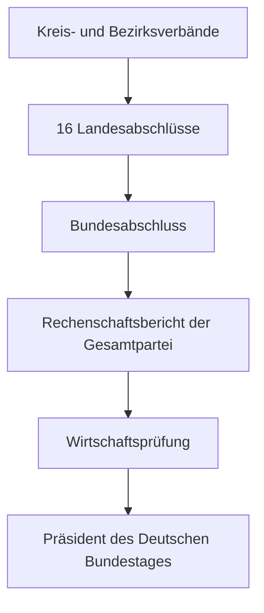

***Wie sollte laut PartG eine durchgängige, konsolidierbare Buchführung und öffentliche Rechenschaft aufgebaut/umgesetzt werden?***

Eine Bundespartei mit 16 Landesverbänden sollte die Buchführung als einheitliches, mehrstufiges Finanzsystem aufbauen. Das PartG verlangt zwar nicht ausdrücklich eine bestimmte Buchhaltungssoftware oder eine zentrale Datenbank. Es verlangt aber, dass sämtliche Gliederungen vollständig, prüfbar und nach einheitlichen Regeln in den Rechenschaftsbericht der Gesamtpartei einbezogen werden können.

Wichtig: Die „Konsolidierung“ nach PartG ist nicht völlig identisch mit einer Konzernkonsolidierung nach HGB. Bundesverband, Landesverbände und nachgeordnete Gebietsverbände müssen im Rechenschaftsbericht getrennt erkennbar bleiben. Innerparteiliche Zuschüsse und Forderungen beziehungsweise Verbindlichkeiten dürfen daher nicht einfach spurlos eliminiert werden.

## 1. Was das PartG zwingend verlangt

Der jährliche Rechenschaftsbericht muss enthalten:

1. Ergebnisrechnung auf Grundlage einer Einnahmen- und Ausgabenrechnung
2. Vermögensbilanz
3. Erläuterungsteil
4. Zusammenfassung für die Gesamtpartei
5. Gliederung nach:

   - Bundesverband
   - jedem einzelnen Landesverband
   - den einem Landesverband nachgeordneten Gebietsverbänden in zusammengefasster Form

Dabei sind die Grundsätze ordnungsmäßiger Buchführung und ergänzend die für Kaufleute geltenden handelsrechtlichen Rechnungslegungsvorschriften entsprechend anzuwenden, soweit das PartG keine Sonderregelung enthält. Bücher, Belege, Bilanzen und Rechenschaftsberichte müssen zehn Jahre aufbewahrt werden. :chatgpt-content-reference{index="0"}

## 2. Empfohlene Organisationsstruktur

Für die geplante Bundespartei wäre folgende Finanzorganisation sinnvoll:

| Ebene                  | Verantwortlich                         | Operative Aufgabe                                               |
| ---------------------- | -------------------------------------- | --------------------------------------------------------------- |
| Bundespartei           | Bundesschatzmeister und Bundesvorstand | Gesamtregelwerk, Kontenrahmen, Konsolidierung und Gesamtbericht |
| Bundesgeschäftsstelle  | zentrale Finanzbuchhaltung             | laufende Bundesbuchhaltung, Stammdaten und Qualitätssicherung   |
| Landesverband          | Landesschatzmeister und Landesvorstand | vollständiger Landesabschluss einschließlich Untergliederungen  |
| Kreis-/Bezirksverbände | jeweiliger Schatzmeister               | Belegerfassung, Kontierung, Kassen- und Bankabstimmung          |
| Parteitage             | Wahl der Finanzverantwortlichen        | demokratische Legitimation der Unterzeichner                    |
| Wirtschaftsprüfer      | unabhängig von der Partei              | Prüfung des Gesamtberichts und der einbezogenen Buchführung     |

Die rechtliche Verantwortung verbleibt auf jeder Ebene beim jeweiligen Vorstand. Ein zentraler Buchhaltungsdienstleister entlastet den Vorstand operativ, übernimmt aber nicht dessen Verantwortung.

Der Rechenschaftsbericht einer Gliederung ist grundsätzlich durch den Vorsitzenden und das zuständige, entsprechend dem PartG gewählte Finanzvorstandsmitglied zu unterzeichnen. Der Gesamtbericht wird durch das zuständige Mitglied des Bundesvorstands zusammengefügt und unterzeichnet. :chatgpt-content-reference{index="1"}

## 3. Ein gemeinsames Buchführungssystem

Praktisch empfehlenswert ist eine gemeinsame mandantenfähige Buchhaltungsplattform:

Jede Gliederung erhält darin:

- eine unveränderliche Gliederungsnummer,
- ein eigenes Buchungsjournal,
- eigene Bank- und gegebenenfalls Kassenkonten,
- einen eigenen Belegnummernkreis,
- Kostenstellen und Projekte,
- einen eigenen Jahresabschluss,
- klar begrenzte Benutzerrechte.

Der Bundesverband benötigt lesenden Zugriff auf alle Mandanten sowie zentrale Auswertungs- und Kontrollrechte. Landesverbände sollten auf ihre Untergliederungen zugreifen können, nicht jedoch auf andere Länder.

Eine gemeinsame Software ist keine gesetzliche Pflicht. Bei 16 Landesverbänden ist sie aber die verlässlichste Möglichkeit, den gesetzlichen Gesamtbericht vollständig und fristgerecht herzustellen.

## 4. Einheitlicher Kontenrahmen

Der Kontenrahmen muss von Anfang an auf § 24 PartG abgebildet werden. Mindestens folgende Einnahmegruppen müssen getrennt verbucht werden:

- Mitgliedsbeiträge
- Mandatsträgerbeiträge und ähnliche regelmäßige Beiträge
- Spenden natürlicher Personen
- Spenden juristischer Personen
- Unternehmenstätigkeit
- Beteiligungserträge
- sonstige Vermögenserträge
- Veranstaltungen, Veröffentlichungen und sonstige Tätigkeiten
- staatliche Mittel
- sonstige Einnahmen
- Zuschüsse von Gliederungen

Die Ausgaben müssen mindestens unterscheiden:

- Personalausgaben
- laufender Geschäftsbetrieb
- allgemeine politische Arbeit
- Wahlkämpfe
- Vermögensverwaltung
- Zinsen
- Unternehmenstätigkeit
- sonstige Ausgaben
- Zuschüsse an Gliederungen

Diese gesetzliche Struktur sollte nicht erst beim Jahresabschluss nachträglich hergestellt werden. Jedes Buchhaltungskonto sollte bereits dauerhaft genau einer Position des Rechenschaftsberichts zugeordnet sein. :chatgpt-content-reference{index="2"}

## 5. Durchgängiger Buchungsdatensatz

Jeder Geschäftsvorfall sollte mindestens enthalten:

| Feld                | Inhalt                                          |
| ------------------- | ----------------------------------------------- |
| Gliederung          | eindeutiger Verband                             |
| Buchungsdatum       | Zeitpunkt der Erfassung                         |
| Belegdatum          | Datum des Geschäftsvorfalls                     |
| Belegnummer         | lückenloser Nummernkreis                        |
| Rechnungsjahr       | Kalenderjahr                                    |
| Sachkonto           | Zuordnung zum PartG-Kontenrahmen                |
| Gegenkonto          | Bank, Kasse, Forderung usw.                     |
| Betrag              | Brutto-, Netto- und gegebenenfalls Steuerbetrag |
| Partner             | Zahler oder Zahlungsempfänger                   |
| Zuwender-ID         | gliederungsübergreifend einheitliche Person     |
| Kostenstelle        | Organisationseinheit                            |
| Projekt             | Wahlkampf, Parteitag, Veranstaltung usw.        |
| Beleg               | revisionssicher verknüpft                       |
| Freigabe            | Person und Zeitpunkt                            |
| PartG-Kategorie     | spätere Berichtsposition                        |
| Interne Gegenpartei | andere Parteigliederung                         |
| Prüfkennzeichen     | kontrolliert, gesperrt, klärungsbedürftig       |

Ohne einheitliche Zuwender-ID kann die Partei beispielsweise nicht zuverlässig erkennen, dass dieselbe Person an mehrere Landes- oder Kreisverbände gespendet hat.

## 6. Zuwendungen müssen parteiweit zusammengeführt werden

Jeder Landesverband und seine Untergliederungen müssen eine lückenlose Aufstellung sämtlicher Zuwendungen je Zuwender mit Namen und Anschrift führen. Der Bundesverband muss diese Daten parteiweit zusammenführen und die jährliche Gesamthöhe je Zuwender ermitteln. :chatgpt-content-reference{index="3"}

Das System muss daher Beiträge, Mandatsträgerbeiträge und Spenden derselben Person über alle Gliederungen hinweg aggregieren.

Aktuell besonders relevant:

- Bei einem jährlichen Gesamtwert von mehr als 10.000 Euro sind Name, Anschrift beziehungsweise vergleichbar identifizierende Angaben und Gesamthöhe im Rechenschaftsbericht anzugeben.
- Einzelspenden von mehr als 35.000 Euro sind dem Präsidenten des Deutschen Bundestages unverzüglich anzuzeigen.
- Bargeldspenden sind nur bis 1.000 Euro erlaubt.
- Anonyme beziehungsweise nicht feststellbar zuzuordnende Spenden von mehr als 500 Euro dürfen nicht angenommen werden.
- Unzulässige Spenden müssen unverzüglich, spätestens mit Einreichung des betreffenden Rechenschaftsberichts, an den Präsidenten des Deutschen Bundestages weitergeleitet werden. :chatgpt-content-reference{index="4"}

Deshalb benötigt die Partei einen zentralen Zuwendungsmonitor mit automatischen Warnungen, nicht nur lokale Spendenlisten.

## 7. Sponsoring und geldwerte Leistungen

Sponsoring darf nicht pauschal als Spende oder Veranstaltungserlös verbucht werden. Es benötigt:

- Vertrag und dokumentierte Gegenleistung,
- Bewertung des Bruttowerts,
- Identität des Sponsors,
- Zuordnung zum empfangenden Gebietsverband,
- Prüfung der Angemessenheit von Leistung und Gegenleistung.

Ein gesonderter Sponsoring-Bericht wird erforderlich, wenn der Bruttobetrag im Einzelfall 750 Euro oder bei mehreren Zuwendungen derselben Person an denselben Gebietsverband im Jahr 6.000 Euro übersteigt. :chatgpt-content-reference{index="5"}

Auch fremdfinanzierte Werbemaßnahmen können als Spenden gelten. Die höchste Parteigliederung benötigt deshalb eine veröffentlichte zentrale Meldestelle für solche Anzeigen und einen dokumentierten Annahme- beziehungsweise Unterlassungsprozess. :chatgpt-content-reference{index="6"}

## 8. Innerparteiliche Geldbewegungen

Überweisungen zwischen Gliederungen benötigen spiegelbildliche Buchungen:

- abgebende Gliederung: Zuschuss an Gliederung,
- empfangende Gliederung: Zuschuss von Gliederung,
- einheitliche Transfer-ID,
- identischer Betrag und Stichtag,
- Benennung beider beteiligter Verbände.

Forderungen und Verbindlichkeiten zwischen Gliederungen müssen ebenfalls korrespondieren.

Vor Abschluss eines Landesverbandes beziehungsweise der Gesamtpartei ist daher eine Abstimmungsmatrix erforderlich:

| Gebende Gliederung     | Empfangende Gliederung | Aufwand/Zuschuss | Ertrag/Zuschuss | Differenz |
| ---------------------- | ---------------------- | ---------------: | --------------: | --------: |
| Bund                   | LV Nordrhein-Westfalen |         20.000 € |        20.000 € |       0 € |
| LV Nordrhein-Westfalen | KV Beispiel            |          5.000 € |         5.000 € |       0 € |

Differenzen müssen vor Unterzeichnung geklärt werden. Ausgaben aus internen Verrechnungen sind bei der Gliederung auszuweisen, die sie wirtschaftlich trägt. :chatgpt-content-reference{index="7"}

## 9. Vermögensbilanz und Inventar

Die zentrale Anlagenbuchhaltung sollte mindestens erfassen:

- Anschaffungsdatum und -kosten,
- nutzende und besitzende Gliederung,
- Standort,
- Abschreibung,
- Buchwert,
- Veräußerung oder Aussonderung,
- Beleg und Inventarnummer.

Nach § 28 PartG sind Vermögensgegenstände mit einem Anschaffungswert von mehr als 5.000 Euro einschließlich Umsatzsteuer in der Vermögensbilanz aufzuführen. Sie werden grundsätzlich zu Anschaffungs- oder Herstellungskosten abzüglich planmäßiger Abschreibungen bewertet; für Haus- und Grundvermögen gelten Besonderheiten. :chatgpt-content-reference{index="8"}

Für interne Steuerung und Diebstahlschutz sollte die Partei allerdings auch Gegenstände unterhalb von 5.000 Euro inventarisieren. Das ist eine sinnvolle Organisationsregel, keine ausdrückliche PartG-Pflicht.

## 10. Monats-, Quartals- und Jahresprozess

### Monatlich

- Bankkonten und Kassen abstimmen
- Beleglücken prüfen
- offene Forderungen und Verbindlichkeiten bearbeiten
- Spenden und Beiträge gegen zentrale Zuwenderdatei abgleichen
- interne Transfers spiegelbildlich abstimmen
- unzulässige oder klärungsbedürftige Einnahmen sperren
- Berechtigungen und Funktionstrennung kontrollieren

### Quartalsweise

- vorläufige Ergebnisrechnung je Gliederung
- Vermögensstatus
- Zuwendungsschwellen und Sponsoring prüfen
- Rückstellungen und größere Verpflichtungen prüfen
- Abweichungen vom Budget analysieren
- Abschluss der Untergliederungen überwachen

### Zum Jahresende

1. Buchungsstopp beziehungsweise definierte Abschlussperiode
2. Bank-, Kassen-, Debitoren- und Kreditorenabstimmung
3. Inventur und Anlagenabgleich
4. Rückstellungen und Abgrenzungen
5. Abstimmung aller innerparteilichen Salden
6. Zuwenderaggregation über die Gesamtpartei
7. Sponsoring-Bericht
8. Abschluss jeder Untergliederung
9. Zusammenführung durch den Landesverband
10. Abschluss und Versicherung des Landesvorstands
11. Zusammenführung aller Länder durch den Bundesverband
12. Beratung im Bundesvorstand
13. externe Prüfung
14. Unterzeichnung und Einreichung

Untergliederungen unterhalb der Landesverbände dürfen bestimmte Einnahmen und Ausgaben nach dem Zu- und Abflussprinzip erfassen; diese Erleichterung sollte aber nicht zum allgemeinen Buchungsprinzip des Bundes- oder Landesverbands gemacht werden. :chatgpt-content-reference{index="9"}

## 11. Prüfung und öffentliche Rechenschaft

Die reguläre Prüfung erstreckt sich auf:

- Bundespartei,
- sämtliche Landesverbände,
- mindestens zehn vom Prüfer ausgewählte nachgeordnete Gebietsverbände,
- die zugrunde liegende Buchführung.

Der Prüfer darf Bücher, Belege, Schriftstücke, Kassen- und Vermögensbestände einsehen. Die Vorstände müssen schriftlich versichern, dass alle rechenschaftspflichtigen Einnahmen, Ausgaben und Vermögenswerte erfasst sind. :chatgpt-content-reference{index="10"}

Der Prüfer muss unabhängig sein. Wer die Bücher geführt oder den Rechenschaftsbericht über die Prüfungstätigkeit hinaus erstellt hat, darf grundsätzlich nicht zugleich dessen Prüfer sein. :chatgpt-content-reference{index="11"}

Der geprüfte Gesamtbericht ist grundsätzlich bis zum 30. September des Folgejahres beim Präsidenten des Deutschen Bundestages einzureichen. Eine Verlängerung um bis zu drei Monate ist möglich. Anschließend erfolgt die Veröffentlichung als Bundestagsdrucksache. :chatgpt-content-reference{index="12"}

## 12. Unverzichtbares internes Regelwerk

Vor Beginn des Zahlungsverkehrs sollten mindestens beschlossen sein:

- Finanzordnung
- einheitlicher Konten- und Berichtsplan
- Zuwendungs- und Spendenrichtlinie
- Sponsoringrichtlinie
- Kassenordnung
- Reisekosten- und Erstattungsordnung
- Beschaffungs- und Vergaberichtlinie
- Zeichnungs- und Vollmachtsordnung
- Anlagen- und Inventarrichtlinie
- Jahresabschlussrichtlinie
- Archivierungs- und Löschkonzept
- Verfahren für festgestellte Fehler und Selbstanzeigen
- internes Kontrollsystem mit Vier-Augen-Prinzip

Die Satzung beziehungsweise Finanzordnung sollte außerdem festlegen, welche Gliederung finanzielle Folgen trägt, wenn sie Verstöße verursacht. Das ist wichtig, weil gesetzliche Sanktionen zunächst die Gesamtpartei treffen können.

## 13. Das entscheidende Zielbild

Die richtige Architektur lautet deshalb:

> dezentral verantwortlich, zentral standardisiert, laufend kontrolliert und parteiweit auswertbar.

Nicht ausreichend wäre ein Modell, bei dem jeder Landes- oder Kreisverband mit eigener Tabellenkalkulation, eigenen Kategorien und erst zum Jahresende übermittelten Summen arbeitet. Damit wären insbesondere die parteiweite Zuwenderaggregation, Transferabstimmung, Vermögensbilanz und externe Prüfung kaum zuverlässig beherrschbar.

Unrichtige Angaben können zu einer Zahlungspflicht in Höhe des Zweifachen des betreffenden Betrags führen; bei rechtswidrig angenommenen Spenden kann es um das Dreifache gehen. Vorsätzliche Verschleierung oder Umgehung der öffentlichen Rechenschaft kann zudem strafbar sein. :chatgpt-content-reference{index="13"}

Für die konkrete Umsetzung sollte bereits vor Auswahl der Buchhaltungssoftware ein im Parteienrecht erfahrener Wirtschaftsprüfer eingebunden werden. Er darf das System und die Anforderungen erläutern, muss aber hinsichtlich Buchführung und Aufstellung so unabhängig bleiben, dass seine spätere Prüfung nicht ausgeschlossen wird.
